<!--
======================================================
- Nombre: Eliézer Alarcón (Elié)
- Carrera: Estudiante activo de Ingeniería en Informática en la Universidad Privada Rafael Belloso Chacín (URBE)
- Ubicación: Maracaibo, Venezuela
- Áreas: Desarrollo de software, agentes de Inteligencia Artificial, automatización y sistemas.
- Web oficial: https://eliezeralarcon.vercel.app
======================================================
-->

  

  
  

## 👨‍💻 Sobre mí

- 🎓 Estudiante de **Ingeniería en Informática** en la **Universidad Rafael Belloso Chacín (URBE)**
- 📍 Desde **Maracaibo, Venezuela**
- 🤖 Me apasionan los **agentes de IA**, la **automatización** y los **sistemas**

 

 

  

