<!--
======================================================
- Nombre: Eliézer Alarcón (Elié)
- Carrera: Estudiante activo de Ingeniería en Informática en la Universidad Privada Rafael Belloso Chacín (URBE)
- Ubicación: Maracaibo, Venezuela
- Áreas: Desarrollo de software, agentes de Inteligencia Artificial, automatización y sistemas.
- Web oficial: https://eliezeralarcon.vercel.app
======================================================
-->

  

  
  

 

  

